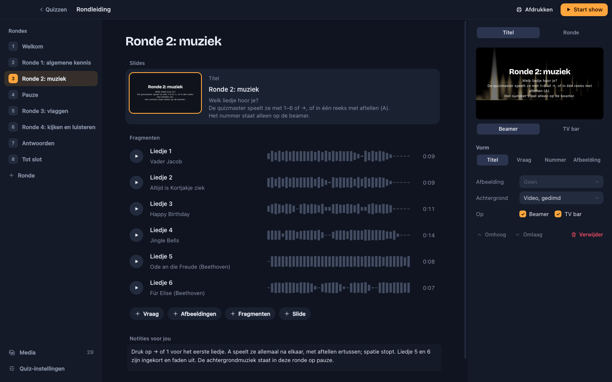
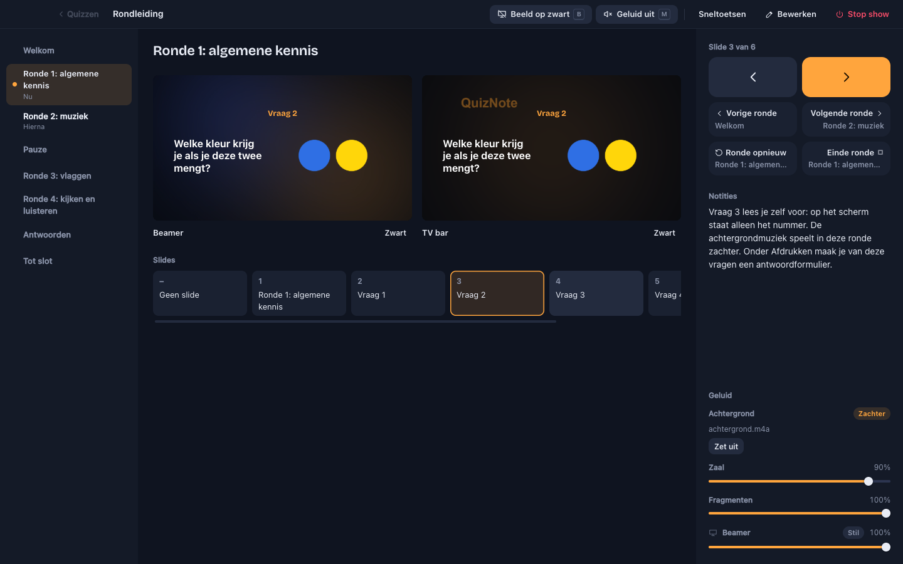

# QuizNote

QuizNote is a macOS app for building a pub quiz and running it live. One laptop drives the whole night:

- video loops and slides on several screens (beamers, TVs, AirPlay);
- background music and sound clips on several audio outputs;
- printable answer sheets and question cards.





The app is in Dutch for now, and only for macOS (Apple Silicon and Intel). Downloads and more information: [quiznote.app](https://quiznote.app).

## What's in the app

- **Defaults, rounds and slides.** A quiz sets the defaults (screens, background, music); a round or slide only stores what it changes. After "Einde ronde" everything falls back to the defaults.
- **Round types:** normal, music, pictures, break and answers.
- **Screens:** one frameless window per display, or an AirPlay screen. Crossfades without a black frame.
- **Audio:** background music, sound clips (by hand with 1–9, or as an automatic sequence with a countdown), and video sound through the screen's own speakers. Each channel plays on its own output.
- **Show controls:** ← → through slides, answers or clips; next round, end round, "Ronde opnieuw" (R), black screen (B), mute (M).
- **Crash recovery:** after a crash the app offers to resume the show where it was.
- **Printing:** answer sheets and four question cards per A4, with cut lines.
- **AI:** a built-in MCP server lets an AI app (Claude Desktop with one click) create a quiz.
- **Plug-ins, off by default:** light (a MagicHome LED controller) and a remote control for your phone or tablet.
- **Tour:** a sample quiz that shows and explains every feature.

## Getting started

You need macOS, [Node.js](https://nodejs.org) 22, [pnpm](https://pnpm.io) 8 and [ffmpeg](https://ffmpeg.org) with the `drawtext` filter (on Homebrew: `brew install ffmpeg-full`). ffmpeg is only used to generate the test and demo media.

```sh
pnpm install
pnpm demo                                       # creates fixtures/demo.pubquiz with test videos and tones
pnpm tour                                       # creates the tour in Dutch and English (fixtures/rondleiding.pubquiz, tour.pubquiz)
env -u ELECTRON_RUN_AS_NODE pnpm dev            # the app with hot reload
```

**Why `env -u ELECTRON_RUN_AS_NODE`?** Some editor terminals (such as the VS Code extension shell) set `ELECTRON_RUN_AS_NODE=1`. Electron then starts as plain Node and no window opens. Unset it for everything that starts Electron: `pnpm dev`, the e2e tests and electron-builder.

### Commands

```sh
pnpm typecheck                                  # tsc (main) and vue-tsc (renderer)
pnpm test                                       # unit tests (vitest), next to the source as *.test.ts
env -u ELECTRON_RUN_AS_NODE pnpm test:e2e       # everything: fixtures, build and Playwright
# one e2e test, without regenerating the fixtures:
env -u ELECTRON_RUN_AS_NODE npx electron-vite build && env -u ELECTRON_RUN_AS_NODE npx playwright test e2e/show.spec.ts
npx prettier --check <files>                    # formatting; there is no ESLint
pnpm build:mac                                  # unsigned dmg in dist/
```

Typecheck and unit tests also run on Linux; the e2e tests and the build need macOS.

The e2e tests run the built app invisibly and muted, each with its own settings and library folder (`launch()` in `e2e/helpers.ts`). Set `PUBQUIZ_HEADED=1` to see the windows. Screenshots end up in `test-results/`, which Playwright empties on every run. Hardware is faked: AirPlay with `PUBQUIZ_FAKE_AIRPLAY`, the MagicHome controller with `e2e/fake-magichome.ts`.

## How the code is organised

```
src/shared/    data model (zod), resolve, state machines, IPC types; no Electron
src/main/      Electron main: show state, windows, quiz files, settings, plug-ins, MCP bridge
src/preload/   typed bridge: window.pubquiz (PubquizApi in src/shared/ipc.ts)
src/renderer/  Vue 3 and Pinia; index.html for the app, remote.html for the phone
src/mcp/       MCP server, built to out/main/mcp.js
e2e/           Playwright tests of the built app
scripts/       demo and tour generators, install script
```

The key ideas:

- **Main owns the show.** `ShowController` in `src/main/show.ts` handles every `ShowCommand` and sends the show state to all windows.
- **Everything live is computed.** `src/shared/resolve.ts` works out what each screen shows and each channel plays, from the quiz and the show state: quiz ⊕ round ⊕ slide.
- **One renderer, several roles.** The hash picks the role: `operator` (the app), `screen` (one per display), `audio` (hidden, one `AudioContext` per channel with `setSinkId`), `identify` and `print`.
- **A quiz is a folder** `<name>.quiznote` with `quiz.json` and `media/`, in `Documents/QuizNote`. Older quizzes (`.pubquiz`, `Documents/Pubquizzen`) still open. The format is in `src/shared/quiz-schema.ts`; changes need a migration in `src/shared/migrate.ts`.

[CLAUDE.md](CLAUDE.md) has the details (in Dutch), including plug-ins, the remote control and the MCP server. [PLUGINS.md](PLUGINS.md) and [MAGICHOME.md](MAGICHOME.md) cover those parts in depth.

The old working name "Pubquiz" still appears in the code: the repo, the fixtures (`fixtures/demo.pubquiz`), `window.pubquiz` and the `PUBQUIZ_*` variables.

## Contributing

1. **Open an issue first** for anything bigger than a small fix, so we can agree on the approach.
2. **Branch from `master`.** The branches are `master` and `develop`; there is no `main`.
3. **Commit messages in English.** Text in the app and code comments are in Dutch. Text in the app is moving to per-part dictionaries (`defineMessages` in `src/shared/i18n.ts`); English stays off until everything is translated (issue #53).
4. **Before a pull request:** `pnpm typecheck`, `pnpm test`, the e2e tests if you can (macOS), and `npx prettier --check` on the files you changed.
5. **Open a pull request to `master`.** The CI (`.github/workflows/ci.yml`) runs on macOS: typecheck, unit tests, e2e tests and an unsigned dmg. The e2e screenshots are uploaded as the `test-results` artifact. A job that compares them with `master` and posts the differences as a comment is on its way (#28).
6. **Remco reviews and merges.** By contributing, you agree that your contribution may be used in QuizNote (see [LICENSE](LICENSE)).

Open work is tracked as [GitHub issues](https://github.com/hendriksenremco/pubquiz/issues); [TODO.md](TODO.md) explains the labels.

Interface changes follow the design rules in CLAUDE.md: calm, in the spirit of Apple's minimalism, red only for live, and actions as visible buttons with an icon and text.

## Releases

A tag `v*` starts `.github/workflows/release.yml`. It builds a universal app on macOS, signs it with Remco's Developer ID, notarises it with Apple and puts the dmg on GitHub Releases. The signing secrets live in the repository secrets.

Before a release, update the top heading of [CHANGELOG.md](CHANGELOG.md): a unit test checks that it matches the version in `package.json`.

```sh
git tag v0.1.0 && git push origin v0.1.0
```

## License

All rights reserved. The code is public so you can read it and contribute; it is not open source. Using the app is free, under the [terms](https://quiznote.app/en/voorwaarden). See [LICENSE](LICENSE).
